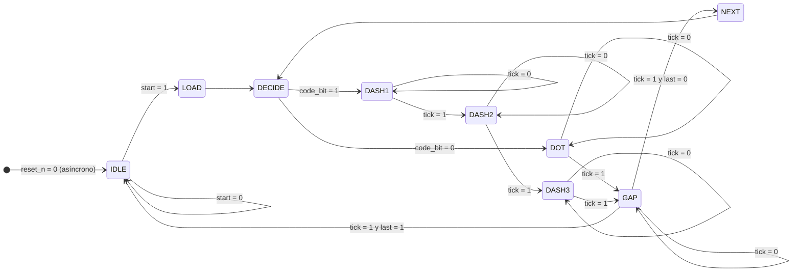

# Diagrama de la máquina de estados (FSM) – Codificador Morse

## Arquitectura general (Figura 5 del enunciado)

```
             SW2..0                         KEY1 (start)    KEY0 (reset asíncrono)
               |                                 |                 |
     +---------v---------+                 +-----v-----------------v-----+
     | Letter selection  |  len(2..0)      |                             |
     | logic (morse_rom) |---------------->| Morse length counter        |--- last ------+
     |                   |  code(3..0)     | (contador de longitud)      |               |
     |                   |---------------->| Morse shift register        |--- code_bit --+
     +-------------------+                 | (registro de corrimiento)   |               |
                                           +-----------------------------+               |
                                              ^ load  ^ shift_en/len_dec                 v
                                              |       |                          +---------------+
                                              +-------+--------------------------|      FSM      |---> LEDR0
                                                                                 |  (morse_fsm)  |
                         +---------------------+         tick                    |               |
                         | Half-second counter |-------------------------------->|               |
                         | (contador 0.5 s)    |<--------------------------------|               |
                         +---------------------+         timer_clr               +---------------+
```

## Codificación de las letras

Cada letra se guarda como un vector de 4 bits (`1` = raya, `0` = punto) que se
transmite desde el bit más significativo, más una longitud de 1 a 4 símbolos.

| Letra | SW  | Morse  | code (3..0) | len |
|-------|-----|--------|-------------|-----|
| A     | 000 | `.-`   | `01--`      | 2   |
| B     | 001 | `-...` | `1000`      | 4   |
| C     | 010 | `-.-.` | `1010`      | 4   |
| D     | 011 | `-..`  | `100-`      | 3   |
| E     | 100 | `.`    | `0---`      | 1   |
| F     | 101 | `..-.` | `0010`      | 4   |
| G     | 110 | `--.`  | `110-`      | 3   |
| H     | 111 | `....` | `0000`      | 4   |

(`-` = no importa, se rellena con `0`).

## Entradas y salidas de la FSM (máquina de Moore)

| Señal       | Dir. | Descripción                                                        |
|-------------|------|--------------------------------------------------------------------|
| `reset_n`   | in   | Reset asíncrono activo en bajo (KEY0)                              |
| `start`     | in   | Pulso de un ciclo al presionar KEY1                                |
| `tick`      | in   | Pulso de un ciclo cada 0.5 s del contador de medio segundo         |
| `code_bit`  | in   | Bit actual (MSB) del registro de corrimiento: `1` raya, `0` punto  |
| `last`      | in   | `1` cuando el contador de longitud indica que es el último símbolo |
| `load`      | out  | Carga el registro de corrimiento y el contador de longitud         |
| `timer_clr` | out  | Reinicia el contador de medio segundo                              |
| `shift_en`  | out  | Desplaza el registro de corrimiento al siguiente símbolo           |
| `len_dec`   | out  | Decrementa el contador de longitud                                 |
| `led`       | out  | Salida Morse hacia LEDR0                                           |

## Diagrama de estados



Versión en texto (por si el visor no soporta Mermaid):

```
 reset_n=0
     |
     v
 +--------+  start=1   +--------+            +-----------+  code_bit=0   +--------+
 |  IDLE  |----------->|  LOAD  |----------->|  DECIDE   |-------------->|  DOT   |
 | led=0  |            | load=1 |            | timer_clr |               | led=1  |
 +--------+            +--------+            +-----------+               +--------+
  ^   ^ |                                      ^     |                       |
  |   | | start=0                              |     | code_bit=1            | tick=1
  |   +-+                                      |     v                       |
  |                                            |  +--------+                 |
  |                                            |  | DASH1  |                 |
  |                                            |  | led=1  |                 |
  |                                            |  +--------+                 |
  |                                            |     | tick=1                |
  |                                            |     v                       |
  |                                            |  +--------+                 |
  |                                            |  | DASH2  |                 |
  |                                            |  | led=1  |                 |
  |                                            |  +--------+                 |
  |                                            |     | tick=1                |
  |                                            |     v                       |
  |                                            |  +--------+                 |
  |                                            |  | DASH3  |                 |
  |                                            |  | led=1  |                 |
  |                                            |  +--------+                 |
  |                                            |     | tick=1                |
  |                                            |     v                       |
  |                            +----------+    |  +--------+                 |
  |                            |   NEXT   |----+  |  GAP   |<----------------+
  |                            | shift_en |       | led=0  |
  |                            | len_dec  |<------+--------+
  |                            +----------+  tick=1  |
  |                                          last=0  |
  +--------------------------------------------------+
                     tick=1, last=1

 Los estados DOT, DASH1..3 y GAP permanecen en sí mismos mientras tick=0.
```

## Tabla de estados y salidas

| Estado | Código | Descripción                                   | load | timer_clr | shift_en | len_dec | led |
|--------|--------|-----------------------------------------------|:----:|:---------:|:--------:|:-------:|:---:|
| IDLE   | 0000   | Espera a que se presione KEY1                 | 0    | 0         | 0        | 0       | 0   |
| LOAD   | 0001   | Carga código y longitud de la letra elegida   | 1    | 0         | 0        | 0       | 0   |
| DECIDE | 0010   | Lee el símbolo actual y reinicia el temporizador | 0 | 1         | 0        | 0       | 0   |
| DOT    | 0011   | Punto: LED encendido 0.5 s                    | 0    | 0         | 0        | 0       | 1   |
| DASH1  | 0100   | Raya, 1er medio segundo                       | 0    | 0         | 0        | 0       | 1   |
| DASH2  | 0101   | Raya, 2do medio segundo                       | 0    | 0         | 0        | 0       | 1   |
| DASH3  | 0110   | Raya, 3er medio segundo                       | 0    | 0         | 0        | 0       | 1   |
| GAP    | 0111   | Separación: LED apagado 0.5 s                 | 0    | 0         | 0        | 0       | 0   |
| NEXT   | 1000   | Pasa al siguiente símbolo                     | 0    | 0         | 1        | 1       | 0   |

## Tabla de transiciones

| Estado actual | Condición              | Estado siguiente |
|---------------|------------------------|------------------|
| IDLE          | `start = 0`            | IDLE             |
| IDLE          | `start = 1`            | LOAD             |
| LOAD          | —                      | DECIDE           |
| DECIDE        | `code_bit = 0`         | DOT              |
| DECIDE        | `code_bit = 1`         | DASH1            |
| DOT           | `tick = 1`             | GAP              |
| DASH1         | `tick = 1`             | DASH2            |
| DASH2         | `tick = 1`             | DASH3            |
| DASH3         | `tick = 1`             | GAP              |
| GAP           | `tick = 1`, `last = 0` | NEXT             |
| GAP           | `tick = 1`, `last = 1` | IDLE             |
| NEXT          | —                      | DECIDE           |
| DOT/DASHx/GAP | `tick = 0`             | (se mantiene)    |

## Ejemplo de temporización – letra C (`-.-.`)

Cada casilla = 0.5 s.

```
t (x0.5 s) :  1  2  3  4  5  6  7  8  9 10 11 12
LEDR0      :  █  █  █  .  █  .  █  █  █  .  █  .
estado     :  DASH1-3  GAP DOT GAP DASH1-3 GAP DOT GAP
```
